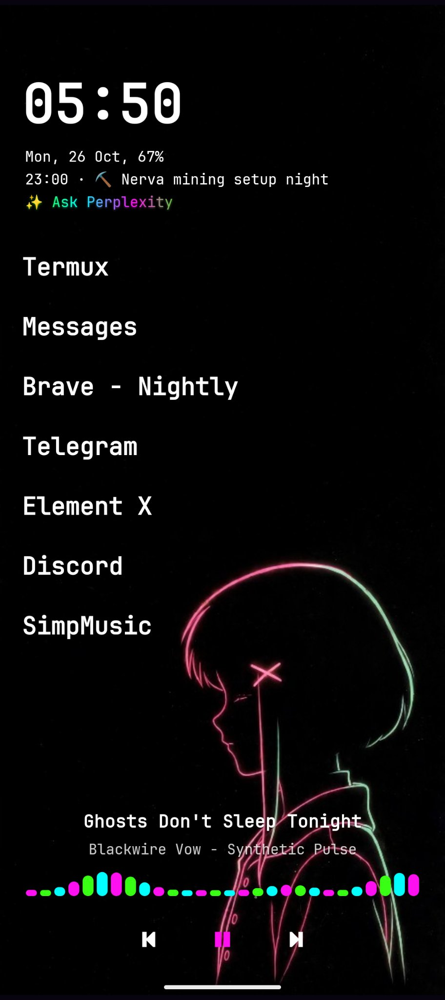

    <h1>navidroid</h1>
    
Minimal and distractionless launcher for Android, by xvoidsx.

     

**navidroid** is a minimal, distractionless launcher for Android — the phone companion to [navi](https://github.com/xvoidsx/navi), carrying the same clean-first, character-second spirit. Your wallpaper, your clock, your apps, your agents: nothing else in the way.

Celebrate the spirit of the Wired, on your phone~

## Screenshots

    

## Features

- **Minimal, distractionless home**. Clock, date, a line for today's calendar events, and a text list of apps. That's the whole home screen.
- **Calendar line**. The current event shows under the date — ongoing events count as current, not just ones starting in the future — and it counts down: “in 40m” for what's coming, “ends in…” for what's on.
- **Default AI Agent**. Pick from a curated list of 19 AI apps in Settings, and a line under the calendar reads “Ask \<name\>” and opens it — or its Play listing if it isn't installed. Long-press the line to switch agents without opening Settings.
- **Agent line glimmer**. The agent line shimmers in nightshadeNeon — a slow pink → green → cyan wave with a ✨ — so it never reads as just another white line.
- **In-launcher wallpaper picker**. Choose any image from inside navidroid; it draws the art fitted, whole, in portrait and landscape — no trip to the system wallpaper picker.
- **Landscape, on your terms**. Portrait-first by default, so a sideways phone never surprises you; flip Allow landscape on in Settings when you want rotation.
- **Up to 8 pinned home apps**. The olauncher-era slots, restored.
- **nightshadeNeon soul**. Neon pink, green, and cyan on near-black, a neon visualizer that dances while music plays, and a custom `>_` icon.
- **Fonts**. Noto Sans and JetBrains Mono alongside the classics.
- **Media widget included**. Control media from home, at the bottom of the screen, with no extra permissions.
- **Privacy-respecting**. No telemetry, no ads, and never will be.

## Install

Latest preview: **v0.2.1**. Grab the APK from [the v0.2.1 release](https://github.com/xvoidsx/navidroid/releases/tag/v0.2.1) — or browse all [Releases](https://github.com/xvoidsx/navidroid/releases) — and install it. Preview builds update over each other, so installing the next one is painless.

[You can also install from the Komi Store!](githubstore://repo/xvoidsx/navidroid) - this will auto-update for you.

## Roadmap

- **Weather line** — sequenced after the agent line and the calendar countdown.
- **Lain bar** — the agent bar, once the agent story behind it is decided.
- Quick capture, voice, swipe-to-Lain.
- Komi Store distribution — the open store pulls straight from GitHub releases, so updates ship on our own cadence, no store queue.

## License

- This project is licensed under the GNU General Public License v3 (GPLv3). See the [LICENSE](./LICENSE) file for details.

## Inspiration

**navidroid** is a hard fork of [Slauncher](https://github.com/s4nj1th/Slauncher), which is itself a fork of the great [Olauncher](https://github.com/tanujnotes/Olauncher).
